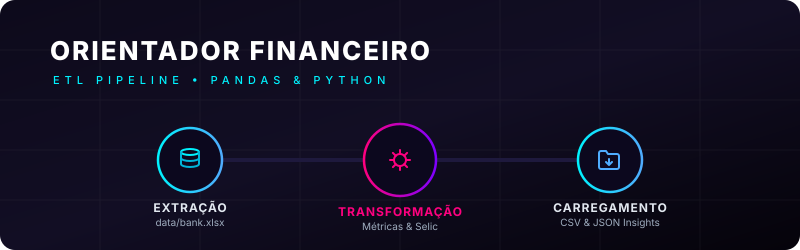
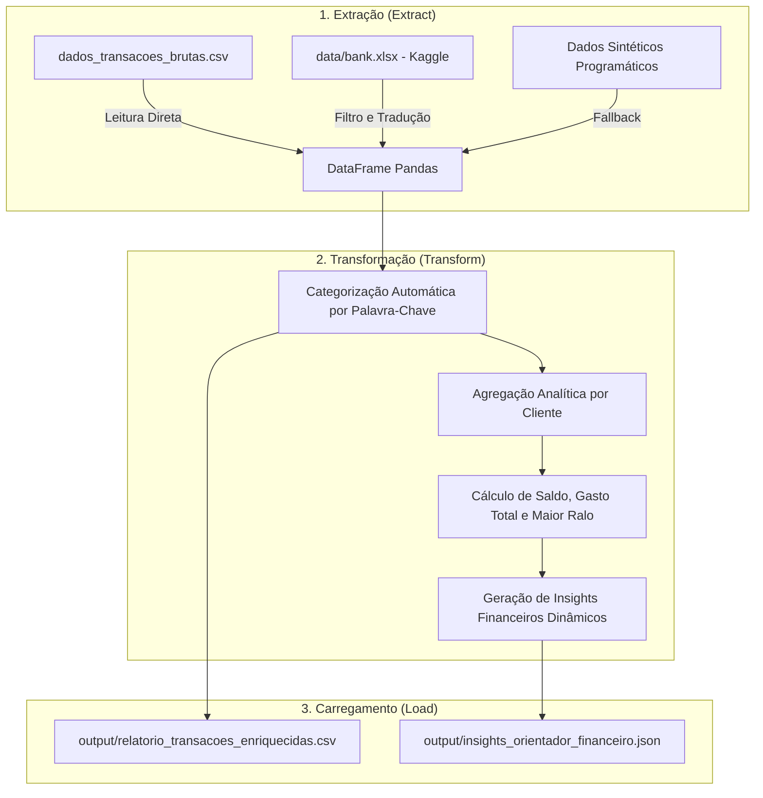

# Pipeline ETL: Orientador Financeiro Personalizado (Kaggle Dataset)



Este projeto implementa uma solução completa de **ETL (Extração, Transformação e Carregamento)** em Python utilizando a biblioteca **Pandas**. O pipeline foi desenvolvido como um projeto de portfólio voltado para Ciência e Engenharia de Dados, simulando o comportamento de uma consultoria financeira automática.

A fonte original de dados de transações brutas é inspirada e compatível com o dataset real **[Bank Transaction Data do Kaggle](https://www.kaggle.com/datasets/apoorvwatsky/bank-transaction-data)**.

---

## 🏗️ Arquitetura do Pipeline ETL

O fluxo de dados é estruturado de maneira modular, com logs detalhados a cada fase do processo:



### 1. Extração (Extract)
O script lê e processa as transações brutas priorizando a seguinte ordem de fontes:
1.  **`dados_transacoes_brutas.csv`**: Carregamento imediato caso o arquivo CSV de transações formatadas já exista.
2.  **`data/bank.xlsx` (Dataset Kaggle)**: Se o arquivo Excel bruto do Kaggle estiver presente, o script seleciona registros de 5 contas diferentes, traduz para nomes em português, formata datas, calcula o valor financeiro líquido (Depósito positivo / Retirada negativa) e injeta descrições brasileiras realistas. O resultado é salvo como `dados_transacoes_brutas.csv` para otimizar futuras execuções.
3.  **Fallback Sintético**: Caso nenhum arquivo esteja disponível, um conjunto de 20 transações realistas de 5 clientes distintos é gerado dinamicamente via Pandas.

### 2. Transformação (Transform)
*   **Enriquecimento de Categorias:** Classificação automática das transações usando termos da descrição:
    *   `Uber` ➡️ **Transporte**
    *   `Supermercado`, `Restaurante` ou `Padaria` ➡️ **Alimentação**
    *   `Netflix`, `Cinema` ou `Shopping` ➡️ **Entretenimento**
    *   `PIX`, `Salário` ou `Rendimento` ➡️ **Receita**
    *   Outros padrões ➡️ **Outros**
*   **Análise Científica:**
    *   **Saldo Final:** Balanço de todas as entradas e saídas.
    *   **Total de Despesas:** Soma do valor absoluto das saídas.
    *   **Maior Ralo Financeiro:** A categoria onde o cliente acumulou o maior gasto em reais.
*   **Módulo Orientador (Insights):** Geração de conselhos específicos para cada cliente. Clientes com saldos saudáveis recebem estimativa de rendimento anual simulado sobre a taxa **Selic (10.5% a.a.)**, enquanto perfis deficitários ou muito apertados recebem alertas de segurança e controle de custos.

### 3. Carregamento (Load)
Os resultados finais consolidados são persistidos localmente na pasta `output/`:
*   **`output/relatorio_transacoes_enriquecidas.csv`**: Histórico detalhado de todas as transações com a coluna de categorização.
*   **`output/insights_orientador_financeiro.json`**: Arquivo JSON mapeando cada cliente para suas métricas chave e o conselho gerado.

---

## 🛠️ Tecnologias e Boas Práticas

*   **Linguagem:** Python 3.x
*   **Processamento e Análise:** Pandas
*   **Boas Práticas:** Padrões PEP 8, código modularizado em funções claras, logs informativos e tratamento de erros (try/except) robusto em todas as operações de E/S.

---

## 🚀 Como Executar o Script

### Pré-requisitos
Ter o Python 3 e o Pandas instalados. Se estiver usando o ambiente virtual criado na workspace:

```bash
# Ativar o ambiente virtual (Linux)
source .venv/bin/activate

# Instalar dependências (caso não tenha feito)
pip install pandas openpyxl
```

### Execução do ETL
Para rodar o pipeline completo:
```bash
python etl_pipeline.py
```

Os logs do terminal mostrarão o progresso de cada fase e os arquivos finais serão criados ou atualizados imediatamente na pasta `output/`.

---

## 📂 Fonte de Dados e Licença

Os dados transacionais utilizados e simulados neste projeto são baseados no dataset público:
*   **Fonte dos Dados:** [Bank Transaction Data (Kaggle)](https://www.kaggle.com/datasets/apoorvwatsky/bank-transaction-data)
*   **Licença:** [CC0: Public Domain](https://creativecommons.org/publicdomain/zero/1.0/) (Domínio Público)

