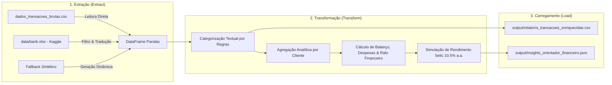

<div align="center">
  

  <br/><br/>

  <p align="center">
    <strong>Pipeline ETL de Inteligência Financeira &amp; Consultoria Automatizada</strong><br/>
    Extração multi-origem, categorização inteligente de transações, enriquecimento de métricas e simulação de investimentos baseada no <strong>Kaggle Bank Transaction Data</strong>.
  </p>
</div>

---

## 📌 1. Visão Geral da Arquitetura do Pipeline

O pipeline foi concebido com arquitetura desacoplada em 3 fases sequenciais com logs detalhados e tratamento robusto de exceções:



---

## 📁 2. Estrutura do Repositório

```text
etl-financial-advisor/
├── assets/                  # Banners dinâmicos e identidades visuais do pipeline
├── data/                    # Diretório contendo dados brutos originais do Kaggle (bank.xlsx)
├── output/                  # Artefatos enriquecidos gerados pelo pipeline (CSV e JSON)
│   ├── relatorio_transacoes_enriquecidas.csv
│   └── insights_orientador_financeiro.json
├── dados_transacoes_brutas.csv # Amostra processada intermediária para execuções rápidas
├── etl_pipeline.py          # Script principal e modular do pipeline ETL completo
├── requirements.txt         # Dependências do ecossistema Python (Pandas, OpenPyXL)
├── banner.svg               # Banner animado em alta resolução
└── README.md                # Documentação técnica e guia de execução
```

---

## ⚙️ 3. Configuração do Ambiente

### Pré-requisitos
- Python 3.9+
- Git

### Instalação

```bash
# 1. Clone o repositório
git clone https://github.com/lucenfort/etl-financial-advisor.git
cd etl-financial-advisor

# 2. Crie e ative o ambiente virtual
python3 -m venv .venv
source .venv/bin/activate  # Linux/macOS
# .venv\Scripts\activate   # Windows

# 3. Instale as dependências
pip install --upgrade pip
pip install -r requirements.txt
```

---

## 🚀 4. Execução dos Componentes

### 4.1 Execução do Pipeline ETL
Para rodar o pipeline completo de ponta a ponta:

```bash
python3 etl_pipeline.py
```

O terminal exibirá logs em tempo real para cada fase (*Extract*, *Transform*, *Load*), e os relatórios enriquecidos serão gravados automaticamente na pasta `output/`.

---

## 📊 5. Regras Analíticas & Insights Gerados

### 5.1 Enriquecimento Semântico de Transações
Classificação automática das movimentações via processamento de termos da descrição:
- `Uber` / `99` ➔ **Transporte**
- `Supermercado` / `Restaurante` / `Padaria` ➔ **Alimentação**
- `Netflix` / `Cinema` / `Shopping` ➔ **Entretenimento**
- `PIX Recebido` / `Salário` / `Rendimento` ➔ **Receita**

### 5.2 Módulo de Consultoria Financeira Automatizada
- **Diagnóstico Orçamentário:** Identificação da categoria com maior evasão financeira (*maior ralo*).
- **Projeção de Renda Fixa:** Simulação de rendimento anual baseado na taxa **Selic (10.5% a.a.)** para clientes superavitários.
- **Alertas de Risco:** Geração de recomendações de contenção de despesas para perfis com balanço negativo ou sob risco de inadimplência.

---

## 📜 Créditos & Conjunto de Dados

- **Dataset Base:** [Bank Transaction Data do Kaggle](https://www.kaggle.com/datasets/apoorvwatsky/bank-transaction-data)
- **Licença:** [CC0: Public Domain](https://creativecommons.org/publicdomain/zero/1.0/) (Domínio Público).

---

## 👨‍💻 Autor

- **Luciano Silva de Arruda**
- Repositório Oficial: [`https://github.com/lucenfort/etl-financial-advisor`](https://github.com/lucenfort/etl-financial-advisor)
- LinkedIn: [Luciano Arruda](https://linkedin.com/in/lucenfort)
